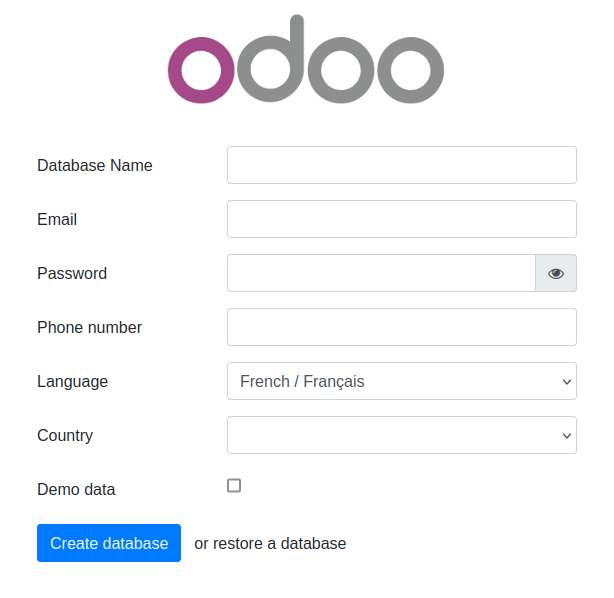
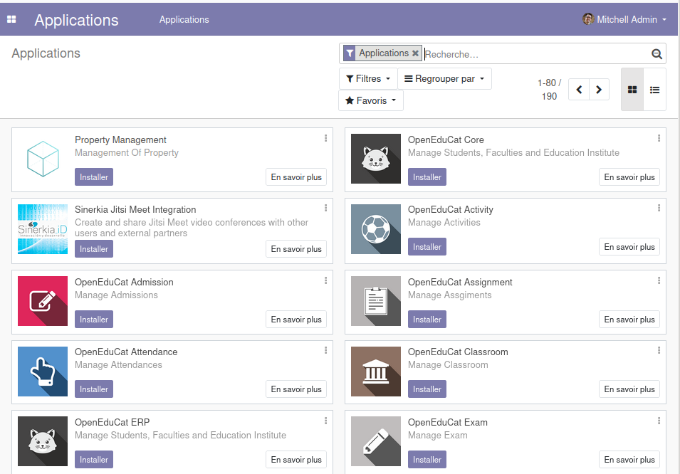

# ERPLibre


ERPLibre est une plateforme CRM/ERP incluant l'installation, la maintenance et le développement automatisés de modules
open source de la version communautaire d'Odoo. C'est un "soft-fork" de l'Odoo Community Edition (OCE), ce qui signifie
qu'il vise à contribuer en amont.
Il est basé sur un ensemble de modules prêts pour la production, supportés par l'Odoo Community Association (OCA) et un
écosystème d'entreprises spécialisées. Cette solution assure la souveraineté numérique dans un environnement local tout
en intégrant des Transformers Génératifs Pré-entraînés (GPT), apportant une dimension supplémentaire à la gestion des
données et à l'automatisation.


Suivez-nous sur Mastodon : https://fosstodon.org/@erplibre


# Fonctionnalités

- **Support multi-version Odoo** : exécutez Odoo 12.0, 13.0, 14.0, 15.0, 16.0, 17.0 et 18.0 dans le même espace de travail, avec des environnements virtuels Python indépendants (`.venv.erplibre` et `.venv.odooXX`)
- **CLI interactif (TODO.py)** : outil interactif guidé pour l'installation, l'exécution, la gestion de bases de données, le formatage de code, la compilation mobile, et plus encore. Lancez-le avec `make`
- **Générateur de code** : générez des modules Odoo automatiquement avec support des vues, portail, snippets, héritage, i18n et JavaScript
- **Automatisation Selenium** : tests web et automatisation avec Selenium Grid, enregistrement vidéo et automatisation de connexion
- **Application mobile** : ERPLibre Home Mobile (Owl + Capacitor), compilée et déployée via TODO.py
- **Déploiement Docker** : images Docker prêtes pour la production avec PostgreSQL 18 et PostGIS
- **Outils de déploiement** : Nginx, Apache, Cloudflare DDNS, Certbot SSL, services systemd
- **Outils de base de données** : sauvegarde, restauration, clonage, migration entre versions, migration production vers développement
- **Outils de performance** : mesure de requêtes par seconde, exécution de tests en parallèle, analyse de couverture


# Versions Odoo supportées


| Odoo version | Python  | Status     |
|--------------|---------|------------|
| 18.0         | 3.12.16 | Active     |
| 17.0         | 3.10.18 | Inactive   |
| 16.0         | 3.10.18 | Inactive   |
| 15.0         | 3.8.20  | Deprecated |
| 14.0         | 3.8.20  | Deprecated |
| 13.0         | 3.7.17  | Deprecated |
| 12.0         | 3.7.17  | Deprecated |


Changez de version avec `make switch_odoo_18`, `make switch_odoo_16`, etc.

Le Python de ce tableau est celui de l'environnement virtuel Odoo.
L'environnement virtuel d'outillage `.venv.erplibre` (TODO, `repo`, formateurs)
tourne sur son propre interpréteur, **3.15.2**, fixé par
`conf/python-erplibre-version`. Là où une distribution ne le porte pas, pyenv
le compile.


# Plateformes supportées

- **Ubuntu** : 24.04, 25.10, 26.04 — 20.04 et 22.04 sont retirées, pikepdf réclamant un qpdf 12.2 bâti en C++20
- **Linux Mint** : 22.3
- **Debian** : 12 (bookworm) et 13 (trixie)
- **Fedora** : 41 et suivantes
- **AlmaLinux, Rocky Linux** : 9 et 10 — RHEL et CentOS Stream empruntent le même chemin
- **openSUSE** : Leap 16.0 et Tumbleweed
- **Arch Linux** : rolling release
- **NixOS** : 25.11 — les dépendances y sont DÉCLARÉES dans `conf/nixos/erplibre.nix` puis appliquées par `nixos-rebuild`, là où les quatre autres familles les installent commande par commande
- **macOS** : par mise ou pyenv
- **Windows** : par WSL ou Docker
- **Architectures** : amd64, arm64 et s390x (mainframe IBM Z). Sur toute autre, `make install_os` et `make install` le disent et demandent s'il faut continuer ; `EL_ALLOW_UNSUPPORTED_ARCH=1 make install_os` répond oui sans question, comme il le faut sans terminal


# Installation en production

## Installation facile sur Ubuntu ou Debian avec Docker

Ceci a été testé sur Debian 12 et Ubuntu 24.04 LTS.

**Note** : Ceci est prévu pour un environnement de test, sur un réseau local ou un environnement similaire non exposé
directement à Internet.


1. Assurez-vous que Docker et le serveur web nginx sont installés :<BR>
   `sudo apt install docker.io docker-compose-v2 nginx`
1. Obtenez le dernier fichier Docker compose d'ERPLibre :<BR>
   `wget https://raw.githubusercontent.com/ERPLibre/ERPLibre/master/docker-compose.yml`
1. Installez et lancez ERPLibre avec Docker en mode daemon (serveur web) :<BR>
   ``sudo docker compose up -d`
1. Ouvrez l'étape finale d'installation à cette page web :<BR>
   `http://[server IP]:8069/web/database/manager`<BR>
   
1. Terminez l'installation en fournissant un nom de base de données, un courriel et un mot de passe, puis cliquez sur **Create Database**.
   Selon les ressources de votre système, **cela peut prendre plus de 2 minutes sans retour visuel !** Vérifiez
   l'indicateur de chargement de votre navigateur.
1. Ensuite, la page web se rechargera automatiquement et vous devriez voir la liste des applications dans ERPLibre :<BR>
   

   Vous pouvez maintenant personnaliser votre installation ERPLibre.


Pour plus d'informations, consultez le [guide Docker](./docker/README.md).

## Installation depuis le code source

### Installation automatisée


Pour Debian/Ubuntu


```bash
sudo apt install make python3
```


Clonez le projet :


```bash
git clone https://github.com/ERPLibre/ERPLibre.git
cd ERPLibre
```


Suivez les instructions du script suivant, il essaiera de détecter votre environnement.


```bash
make
```


`make` et `./install.sh` lancent TODO par l'interpréteur capable de le lire :
`.venv.erplibre` quand il porte la bonne version, sinon le `python3` du système
s'il est assez récent, sinon l'installation elle-même — un système plus ancien
que `conf/python-erplibre-version` ne sait pas analyser le code, donc
l'installation est proposée plutôt que de s'arrêter sur une erreur de syntaxe.
Elle ne part que sur un oui tapé au terminal (`o`, `oui`, `y` ou `yes`) ;
Entrée seule, ou l'absence de terminal, vaut non. Quand
l'environnement manque mais que le Python du système suffit, TODO propose de
lancer `./script/install/install_erplibre.sh` (dans un terminal) ou affiche
cette commande. L'installation bâtit l'environnement par
`EL_PYTHON_PROVIDER` (mise ou pyenv) ; un `.venv.erplibre` existant sur une
autre version de Python est SUPPRIMÉ puis rebâti, et ce qu'on y avait posé à la
main part avec lui.


### Installation non interactive

Sans personne au clavier — une VM, une CI, un script — le menu Installation
de TODO prend ses réponses d'avance et ne demande rien :


```bash
./todo.sh install --non-interactive --target 18.0 --env dev --type standard --system yes
make install_non_interactive EL_INSTALL_TARGET=18.0 FREEZE=0 EL_WITH_EXTRA=0 EL_INSTALL_SYSTEM=1
```


| Réponse | Option | Variable |
|---|---|---|
| version d'Odoo, ou `q`, `w` comme dans le menu | `--target` | `EL_INSTALL_TARGET` |
| développement ou production (version d'Odoo seulement) | `--env dev\|prod` | `EL_FREEZE=0\|1` (make : `FREEZE`) |
| modules extra (version d'Odoo seulement) | `--type standard\|extra` | `EL_WITH_EXTRA=0\|1` |
| paquets du système d'abord | `--system yes\|no` | `EL_INSTALL_SYSTEM=0\|1` |
| poser mise plutôt que compiler Python (quand mise est absent) | `--mise yes\|no` | `EL_INSTALL_MISE=0\|1` |
| identité git, facultative | `--git-name`, `--git-email` | `EL_GIT_NAME`, `EL_GIT_EMAIL` |

Une option l'emporte sur sa variable. Aucune de ces réponses n'a de défaut :
une réponse manquante arrête l'installation avant qu'elle commence — avant
même le venv d'outillage d'un clone neuf — en nommant l'option et la
variable qui la donnent. La cible `m` est refusée dans ce mode : sa dernière
étape fait choisir un appareil Android au clavier. Sans `--non-interactive`
(ou `EL_NON_INTERACTIVE=1`), les réponses données servent et les autres sont
demandées.

Dans ce mode, `EL_NON_INTERACTIVE=1` atteint chaque script de
l'installation : apt ne pose aucune question et garde un fichier de
configuration modifié localement, needrestart se contente de lister les
services à relancer, git, pip et poetry ne demandent jamais d'identifiants,
et mise ne demande jamais d'approuver un fichier de configuration. sudo ne
peut pas demander de mot de passe : ouvrez un ticket sudo juste avant
(`sudo -v`), que l'installation garde vivant jusqu'à la fin, ou donnez au
compte un sudo sans mot de passe ; sinon l'installation s'arrête aussitôt et
le dit. Une architecture non supportée
demande toujours `EL_ALLOW_UNSUPPORTED_ARCH=1`. Sans identité git, `repo
init` tourne sans en demander.

Qui part du menu peut aussi s'en aller une fois les premières questions
répondues : après la question système, **Suite de l'installation** offre
*Sans interaction* (défaut, Entrée) ou *Interactive* ; la cible `m` ne l'offre
pas. Sans interaction, chaque question suivante prend sa réponse par défaut
— aucune identité git n'est écrite, mise est posé s'il manque sauf
`--mise no` ou `EL_INSTALL_MISE=0`, PyCharm n'est pas proposé — et, si
l'étape système a été choisie, sudo demande son mot de passe à ce moment,
une seule fois, tant que quelqu'un est là.


### Manuellement

Sous Ubuntu, dépendance minimale :


```bash
sudo apt install make git curl
```


Sous Ubuntu, dépendance développeur :


```bash
sudo apt install make build-essential libssl-dev zlib1g-dev libreadline-dev libsqlite3-dev curl llvm libncurses5-dev libncursesw5-dev xz-utils tk-dev liblzma-dev libbz2-dev libldap2-dev libsasl2-dev
```


Clonez le projet :


```bash
git clone https://github.com/ERPLibre/ERPLibre.git
cd ERPLibre
```


`make install_os` détecte la distribution et choisit le bon script de dépendances : apt pour Ubuntu, Linux Mint et Debian, dnf pour Fedora et la famille RHEL, zypper pour openSUSE, pacman pour Arch, et un module déclaratif pour NixOS. Voir les plateformes supportées ci-dessus.


```bash
make install_os
make install_odoo_18
```


Installez une version spécifique d'Odoo :


```bash
make install_odoo_16
make install_odoo_17
make install_odoo_18
```


Mettez à jour votre configuration si vous devez exécuter depuis une autre interface que 127.0.0.1, fichier `config.conf`


```
xmlrpc_interface = 0.0.0.0
```


Afficher la version :


```bash
make version
```


Prêt à exécuter :


```bash
make run
```


# Test

Exécutez les tests ERPLibre avec son générateur de code.


```bash
time make test_full_fast
```


# Documentation

| Guide | Description |
|-------|-------------|
| [DISCOVER](doc/DISCOVER.md) | Découvrir et explorer ERPLibre |
| [DEVELOPMENT](doc/DEVELOPMENT.md) | Configuration de l'environnement de développement |
| [PRODUCTION](doc/PRODUCTION.md) | Déploiement du serveur de production |
| [RUN](doc/RUN.md) | Modes d'exécution et cas d'utilisation |
| [CODE_GENERATOR](doc/CODE_GENERATOR.md) | Génération de code de modules Odoo |
| [MIGRATION](doc/MIGRATION.md) | Migration de base de données entre versions |
| [GIT_REPO](doc/GIT_REPO.md) | Gestion des dépôts Git |
| [IMPROVE_ODOO](doc/improve_odoo.fr.md) | Le fork Odoo d'ERPLibre et ses correctifs |
| [POETRY](doc/POETRY.md) | Gestion des dépendances Python |
| [FAQ](doc/FAQ.md) | Foire aux questions |
| [HOWTO](doc/HOWTO.md) | Guides pratiques |
| [WINDOWS_INSTALLATION](doc/WINDOWS_INSTALLATION.md) | Installation sous Windows |


# Contribution

Consultez [CONTRIBUTION.md](doc/CONTRIBUTION.md) pour les directives.


# Licence

Ce projet est sous licence [GNU Affero General Public License v3.0](LICENSE).